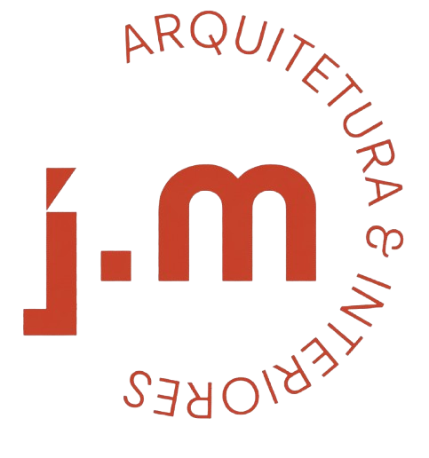
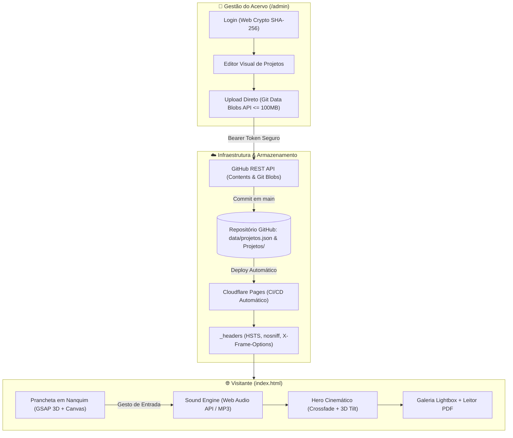

# J.Meuren | Arquitetura • Interiores

<div align="center">



**"Arquitetura é música edificada."**  
*Projetos residenciais, comerciais e interiores autorais guiados pela luz natural, proporção e identidade.*

[](https://jmeurenarquitetura.com.br)
[](https://jmeurenarquitetura.com.br/admin/)
[](https://pages.cloudflare.com/)
[](#-segurança-e-auditoria-owasp)

</div>

---

## 🏛️ Visão Geral

Website institucional e portfólio autoral do arquiteto **J. Meuren**, com mais de 25 anos de experiência em projetos residenciais, comerciais e interiores em Brasília e região.

O projeto foi concebido sob padrões editoriais de alta fidelidade visual (inspirados em referências premiadas como *unseen.co* e *Mobbin*), combinando:
1. **Prancheta Arquitetônica Viva (Splash Screen):** Croqui autoral em nanquim com parallax 3D interativo via GSAP, feixe de luz solar volumétrico e partículas em Canvas 2D.
2. **Experiência Sonora Imediata:** Sound Engine com sintetizador Web Audio API e trilha ambiente orquestrada, ativada no primeiro clique sem bloqueio de autoplay dos navegadores.
3. **Vitrine Dinâmica de Projetos:** Hero cinemático com transição contínua e tilt 3D, esteira interativa (Roller 3D), galeria lightbox em alta resolução e leitor integrado de memoriais e pranchas em PDF.
4. **CMS Próprio Integrado ao GitHub (`/admin`):** Painel administrativo visual para cadastro, ordenação e publicação direta no repositório via API do GitHub, com suporte a uploads de fotos e PDFs de até 100MB sem necessidade de backend intermediário.

---

## 📐 Diagrama de Arquitetura



---

## ⚡ Principais Funcionalidades

### 1. Prancheta Arquitetônica de Boas-Vindas (`#welcomeSplash`)
- **Croqui em Nanquim (`assets/ilustracao-nanquim.png`):** Desenho autoral com efeito *Ken Burns* de câmera lenta e reflexo de luz natural.
- **Carimbo Técnico 3D:** Emblema arquitetônico com coordenadas técnicas de Brasília (`15°47'38"S · 47°52'58"W`), reagindo à movimentação do cursor com física inercial (`gsap.quickTo`).
- **Canvas de Partículas de Luz:** Simulação em 60fps com tratamento de densidade de pixels (`devicePixelRatio`) e desativação automática para usuários com `prefers-reduced-motion`.
- **Desbloqueio de Áudio:** O clique em *"Iniciar Experiência Sonora"* (ou <kbd>ESC</kbd> para modo silencioso) inicia a trilha ambiente sem erros de autoplay.

### 2. Palco Principal e Portfólio Vivo
- **Inércia Suave com Lenis:** Rolagem fluida inspirada em estúdios de design internacionais.
- **Hero Interativo:** Barra de progresso contínua, alternância automática entre fotos internas do projeto e visualizador de índice lateral.
- **Visualizador Duplo (Lightbox + PDF):**
  - Galeria fotográfica com suporte a toque (swipe mobile), navegação por teclado (<kbd>←</kbd> / <kbd>→</kbd>) e zoom.
  - Leitor de pranchas arquitetônicas e memoriais descritivos em PDF com fallback imediato anti-cache via espelho do GitHub Raw.

### 3. Painel Administrativo Autônomo (`/admin`)
- **Segurança Criptográfica:** Autenticação local protegida por hash `SHA-256` via Web Crypto API.
- **Gestão de Projetos:** Cadastrar, editar títulos, memoriais, categorias (Residencial, Comercial, Interiores), reordenar posição de exibição e selecionar a foto de capa.
- **Uploads até 100MB:** Utiliza a **GitHub Git Data Blobs API** para contornar limitações padrão de 25MB da API de Contents, permitindo pranchas pesadas em PDF e acervos fotográficos em alta resolução.
- **Cache-Buster Inteligente:** Cabeçalhos `If-None-Match: ''` e parâmetros temporais para evitar erros `409 Conflict` por cache do GitHub.

---

## 📂 Estrutura de Pastas

```text
jmeurenarquitetura/
├── _headers                   # Cabeçalhos HTTP de segurança para Cloudflare Pages
├── index.html                 # Aplicação principal do portfólio (SPA)
├── admin/                     # Painel de controle do acervo
│   └── index.html             # Interface do CMS administrativo
├── data/
│   └── projetos.json          # Banco de dados de projetos e configurações
├── assets/                    # Identidade visual, ilustrações e áudio
│   ├── ilustracao-nanquim.png # Croqui autoral da tela de boas-vindas
│   ├── LogoJmeuren-removebg.png
│   ├── sobre.jpg              # Foto de perfil profissional do arquiteto
│   └── ambient.mp3            # Trilha sonora ambiente em alta fidelidade
├── Projetos/                  # Acervo fotográfico e pranchas organizadas por projeto
│   ├── apart314norte/         # Imagens/ e Pdf/
│   ├── apart403norte/
│   ├── apart410norte/
│   ├── apartParkSul/
│   ├── gourmetcondriachofundo/
│   ├── inovacafe/
│   └── residenciaPonteAlta/
├── DESIGN.md                  # Especificação do Design System e tokens de interface
├── PRODUCT.md                 # Visão de produto, proposta de valor e público-alvo
└── README.md                  # Este documento
```

---

## 🛠️ Tecnologias e Bibliotecas

| Componente | Tecnologia | Finalidade |
| :--- | :--- | :--- |
| **Linguagens Base** | HTML5, CSS3, JavaScript (ES6+ Vanilla) | Máxima performance, sem dependência de frameworks ou build steps |
| **Rolagem Suave** | [Lenis 1.1.18](https://lenis.darkroom.engineering/) | Rolagem inercial de alta fidelidade |
| **Animações & 3D** | [GSAP 3.12.5](https://greensock.com/gsap/) + ScrollTrigger | Transições, animações de entrada e parallax 3D |
| **Ícones** | [Font Awesome 6.5.1](https://fontawesome.com/) | Tipografia iconográfica vetorial |
| **Tipografia** | *Instrument Serif*, *Hanken Grotesk*, *IBM Plex Mono* | Equilíbrio entre elegância autoral e rigor técnico |
| **Hospedagem** | [Cloudflare Pages](https://pages.cloudflare.com/) | Edge CDN global com deploys atômicos a cada commit |

---

## 🔒 Segurança e Auditoria OWASP

O projeto foi auditado e blindado conforme as diretrizes **OWASP Top 10** e **CWE Top 25**:

- **Subresource Integrity (SRI):** Todas as bibliotecas de CDNs externas possuem hashes `sha384` e `crossorigin="anonymous"`, protegendo contra ataques de cadeia de suprimentos.
- **Cabeçalhos HTTP (`_headers`):**
  - `Strict-Transport-Security: max-age=31536000; includeSubDomains; preload` (HSTS de 1 ano).
  - `X-Content-Type-Options: nosniff` (impede MIME-sniffing).
  - `X-Frame-Options: SAMEORIGIN` no site e `DENY` no `/admin` (anti-clickjacking).
  - `X-Robots-Tag: noindex, nofollow` em `/admin*` (impede indexação do painel por buscadores).
  - `Permissions-Policy` bloqueando câmera, microfone, geolocalização e USB.
- **Prevenção de DOM-XSS:** Todas as variáveis inseridas no DOM utilizam a função de sanitização `esc()`, e URLs são validadas contra esquemas perigosos (`javascript:`, `vbscript:`, `data:text/html`).
- **Validação de Uploads:** Sanitização de nomes de arquivo contra *path traversal* (`../`, barras invertidas) e lista estrita de extensões permitidas (`jpg`, `jpeg`, `png`, `webp`, `avif`, `gif`, `pdf`, `mp3`, `wav`, `ogg`, `m4a`).

---

## 💻 Como Rodar Localmente

Como o projeto é estático, você pode executar um servidor web local com qualquer utilitário simples:

### Opção 1: Python (Recomendado)
```bash
# Na raiz do repositório:
python -m http.server 3000
```
Acesse em seu navegador:
- Site: [http://localhost:3000](http://localhost:3000)
- Painel: [http://localhost:3000/admin/](http://localhost:3000/admin/)

### Opção 2: Node.js (npx serve)
```bash
npx serve -l 3000
```

---

## 📝 Como Cadastrar e Atualizar Projetos

1. Acesse o painel em `https://jmeurenarquitetura.com.br/admin/`.
2. Insira as credenciais de acesso do estúdio.
3. Configure o **Token Pessoal do GitHub** na aba *Backup, Senha & GitHub* (necessário apenas na primeira vez em cada navegador).
4. Clique em **"+ Novo Projeto"**, preencha os dados e arraste as fotos e a prancha em PDF.
5. Clique em **"Confirmar e Salvar Projeto"** e em seguida em **"Salvar Alterações no Site"**.
6. O commit é enviado automaticamente para o GitHub e a Cloudflare Pages atualiza o site em cerca de 45 segundos!

---

<div align="center">

**J.Meuren Arquitetura & Interiores**  
Brasília, DF • Brasil  
*Todos os direitos reservados.*

</div>

